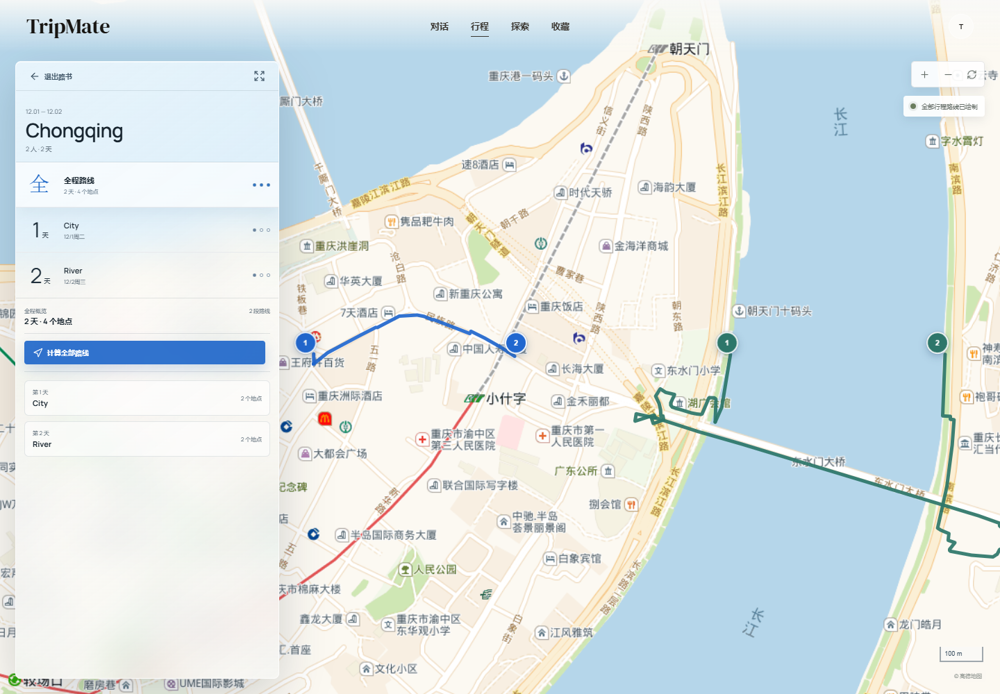
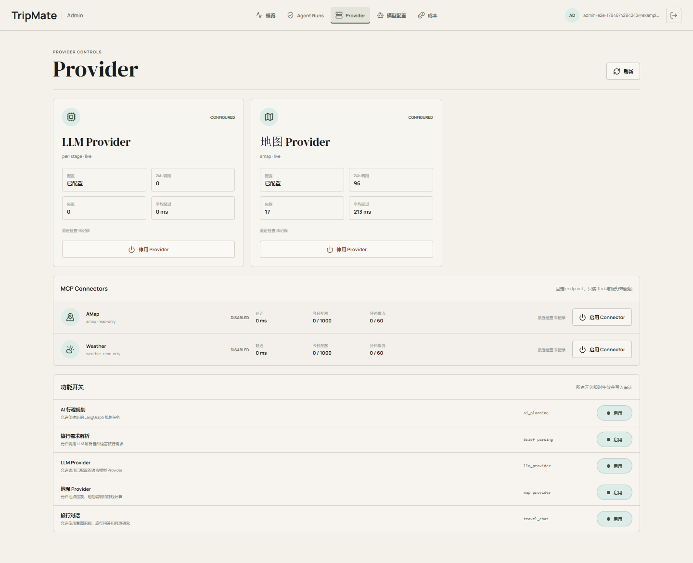
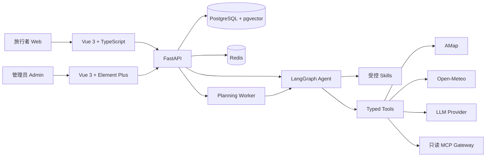

<div align="center">

# TripMate

**把一段旅行愿望，变成一份可以修改、验证和分享的真实路书。**

[](CHANGELOG.md)
[](LICENSE)
[](https://vuejs.org/)
[](https://fastapi.tiangolo.com/)
[](https://www.postgresql.org/)
[](CONTRIBUTING.md)

TripMate 是一个中文优先、可自托管的 AI 旅行规划与行程工作台。它不只生成一段建议，
而是把旅行需求、真实地点、路线、预算、事实来源和可编辑路书连接成一个完整流程。

[核心能力](#核心能力) · [产品预览](#产品预览) · [快速启动](#快速启动) ·
[架构](#系统架构) · [配置](#配置) · [参与贡献](#参与贡献)

</div>

---

## 为什么做 TripMate

旅行规划真正困难的部分，通常不是“列出几个景点”，而是：

- 需求经常不完整，目的地、日期、预算和同行人会逐步澄清。
- 地点、天气、交通和开放信息来自不同 Provider，容易过期或互相冲突。
- AI 容易编造地点、价格、营业时间和路线。
- 一份可执行的行程必须能编辑、排序、计算预算、恢复版本并分享。
- AI 系统还必须能审计 Tool 调用、限制成本、回退故障并保护用户数据。

TripMate 的设计原则是：

> AI 负责理解和编排，确定性 Tool 负责事实、路线与预算，数据库负责状态，管理员负责回滚。

## 核心能力

### AI 旅行规划

- 用自然语言描述目的地、日期、人数、预算、兴趣、住宿偏好和同行人约束。
- 支持图片、PDF、TXT 和 Markdown 附件参与需求理解。
- LangGraph 单主 Agent 编排需求解析、地点研究、行程生成、规则校验与有限修复。
- 受控 Skill Router 根据旅行意图选择研究、路线、预算、天气、餐饮、住宿和安全 Skill。
- 连续对话保存结构化 `planning_draft`，支持跨轮日期、人数、预算和交通偏好合并。
- 用户可在对话中自动创建、更新和重新规划行程，旧行程版本可恢复。
- 长对话使用独立消息滚动区和固定输入区，并在模型思考时显示加载反馈。
- EvidenceRecord 记录 Provider、查询时间、freshness、置信度和来源。
- 未知或过期事实显式标记，不用猜测填补价格、营业时间或坐标。
- 支持 Mock 模式进行确定性测试，也支持 OpenAI-compatible Live 模型。

### 可以继续编辑的路书

- 创建、编辑、归档旅行，按日期组织逐日行程。
- 搜索真实地点，设置开始时间、停留时长、预计花费和交通方式。
- 拖拽或按钮调整顺序，使用版本号与乐观并发控制避免静默覆盖。
- 地图支持地点标记、步行、驾车、骑行、公交和地铁路线。
- 全程路书汇总多天地点与路线，不把交通方式伪装成真实班次。
- 预算和支出统一使用整数最小货币单位，避免浮点金额误差。

### 基于事实的旅行研究

- 高德地图 Web Service：地点搜索、地点详情、周边、路线、天气。
- Open-Meteo：天气降级、城市地理编码、海拔。
- DeepSeek / OpenAI-compatible：需求解析、研究规划、行程编排和旅行问答。
- Provider 返回事实与 LLM 输出分离，模型不能直接计算真实路线和金额。
- 实时事实必须保存来源、查询时间和置信度；无法确认时返回 `unknown`。

### 收藏、分享与旅行记忆

- 收藏地点和旅行，支持收藏夹、备注、搜索、移动和 JSON 导出。
- 创建可撤销、有时效的只读分享链接。
- 分享页不暴露预算、支出和私人备注。
- 支持浏览器打印、PDF 和图片导出。
- 旅行记忆由用户显式授权，可逐条查看、停用、删除或全部清除。

### 管理与可观测性

- 管理员独立登录，所有写操作使用服务端角色校验。
- Agent Runs 展示模型、Token、延迟、Tool 调用、Skill 版本、Router 置信度和回退原因。
- 成本页按 Provider、模型和 Skill 聚合；Skill 成本在运行内均摊。
- Provider 页显示地图、模型、MCP connector 和本地 Tool 健康状态。
- Skills 页展示 manifest 版本、允许 Tool/MCP、预算、更新人和审计记录。
- 功能开关支持即时回滚 Agent Skills、Skill Router 和 MCP Gateway。
- 模型密钥只返回“是否已配置”，不在前端或日志中返回明文。

### 安全边界

- 用户、旅行、地点、收藏、分享、上传和记忆均校验 resource ownership。
- JWT 鉴权、Argon2 密码哈希、管理员角色校验、Redis 限流。
- 外部 URL 阻断私网、回环、链路本地地址和危险重定向。
- 上传文件校验类型、大小、数量、文件头和图片结构。
- 生产上传通过 ClamAV `INSTREAM` 扫描；扫描不可用时失败关闭。
- 用户文本、附件、Tool 结果和 MCP 内容都按不可信数据处理。
- Tool 调用有 Schema、超时、调用预算、deadline 和审计。
- MCP Gateway 只接受服务端固定 endpoint，不支持用户 URL 或 Shell 执行。
- 真实 AMap/Weather Streamable HTTP MCP Server 支持受控调用、健康检查与本地降级。

## 产品预览

<p align="center">
  
  
</p>

<p align="center">
  
</p>

## 系统架构



### 仓库结构

```text
apps/
  web/       旅行者 Web 客户端
  admin/     运营与管理后台
  api/       FastAPI、Agent、Skills、Tools、Worker 和数据库迁移
skills/      Skill Manifest、任务方法与输出契约
tests/       浏览器 E2E、性能与 Skill 质量评测
infra/       Nginx 与部署配置
scripts/     本地启动、构建、备份、恢复和发布辅助脚本
prototypes/  产品视觉参考原型
```

## 技术栈

| 层级 | 技术 |
| --- | --- |
| Web | Vue 3、TypeScript、Vite、Pinia、TanStack Query、MapLibre GL |
| Admin | Vue 3、TypeScript、Element Plus、Lucide |
| API | Python 3.11+、FastAPI、Pydantic v2、SQLAlchemy 2 |
| Agent | LangGraph、Function Calling、受控 Skills / Tools |
| 数据库 | PostgreSQL 16、pgvector、Alembic |
| 缓存与队列 | Redis |
| 外部数据 | AMap Web Service、Open-Meteo、OpenAI-compatible LLM |
| 测试 | Pytest、httpx、Vitest、Playwright |
| 交付 | Docker Compose、pnpm、uv |

## 快速启动

### 前置要求

- Docker Desktop 或 Docker Engine + Compose
- Node.js 22+
- Corepack / pnpm 11
- Python 3.11 或 3.12
- [uv](https://docs.astral.sh/uv/)

### 1. 获取代码

```bash
git clone https://github.com/Seventy7photograph/TripMate.git
cd TripMate
```

### 2. 安装依赖

```bash
corepack enable
corepack pnpm install
uv sync --project apps/api
```

### 3. 配置环境

Linux / macOS：

```bash
cp .env.example .env
```

Windows PowerShell：

```powershell
Copy-Item .env.example .env
```

本地体验可先保留 Mock Provider。使用真实模型和高德时，再填写
`LLM_API_KEY`、`LLM_BASE_URL` 和 `AMAP_WEB_SERVICE_KEY`。

### 4. 启动完整开发环境

```bash
corepack pnpm dev
```

该命令会：

1. 启动 PostgreSQL 和 Redis。
2. 执行 Alembic 迁移。
3. 启动 Web、Admin、API 和 Planning Worker。

默认入口：

| 服务 | 地址 |
| --- | --- |
| Web | http://localhost:5173 |
| Admin | http://localhost:5174 |
| API | http://localhost:8000 |
| OpenAPI | http://localhost:8000/docs |
| Health | http://localhost:8000/api/v1/health |

### 5. 创建管理员

先通过 Web 注册普通账号，再执行：

```bash
corepack pnpm --filter @tripmate/api promote-admin -- admin@example.com
```

管理员账号即可登录 Admin。

## Docker 部署

```bash
docker compose --profile app up -d --build --wait
```

默认端口：

- Web：`http://localhost:8080`
- Admin：`http://localhost:8081`
- API：`http://localhost:8000`

停止：

```bash
docker compose --profile app down
```

生产环境必须配置 HTTPS、可信反向代理、独立数据库、Secret 管理和备份策略。

## 配置

完整模板见 [`.env.example`](.env.example)。

### Provider

| 变量 | 说明 |
| --- | --- |
| `PROVIDER_PROFILE` | `mock` 或 `live` |
| `MAP_PROVIDER_PROFILE` | 地图与天气 Provider 模式 |
| `AMAP_WEB_SERVICE_KEY` | 高德 Web Service Key |
| `OPEN_METEO_BASE_URL` | Open-Meteo 天气与海拔接口 |
| `WEATHER_FALLBACK_ENABLED` | 是否启用 Open-Meteo 天气降级 |
| `LLM_BASE_URL` | OpenAI-compatible API 地址 |
| `LLM_API_KEY` | 服务端模型密钥 |
| `LLM_MODEL` | 默认模型 |

### 数据与安全

| 变量 | 说明 |
| --- | --- |
| `DATABASE_URL` | PostgreSQL 连接 |
| `REDIS_URL` | Redis 连接 |
| `JWT_SECRET` | JWT 签名密钥，生产必须随机且至少 32 字符 |
| `MODEL_CONFIG_ENCRYPTION_KEY` | 在线模型密钥加密密钥 |
| `ALLOW_PRIVATE_PROVIDER_URLS` | 生产环境应保持 `false` |
| `PROVIDER_ALLOWED_HOSTS` | 可选的 Provider host allowlist |
| `CLAMAV_HOST` / `CLAMAV_PORT` | 生产上传恶意文件扫描 |
| `OUTBOUND_PROXY_URL` | 生产 Provider 的受控出站代理，代理需固定 DNS 并限制重定向 |

### MCP Gateway

MCP 默认关闭。启用前需要：

```dotenv
MCP_GATEWAY_ENABLED=true
MCP_ALLOWED_CONNECTORS=amap,weather
MCP_AMAP_ENDPOINT=https://your-approved-mcp.example/amap
MCP_WEATHER_ENDPOINT=https://your-approved-mcp.example/weather
```

MCP endpoint 只能由服务端配置。Admin 页面只允许启停 connector，不接受 URL、
凭据或脚本。

## 测试与质量

```bash
corepack pnpm verify
corepack pnpm e2e
```

依赖安全：

```bash
corepack pnpm audit --audit-level high
python -m uv tool run pip-audit --path apps/api/.venv
```

分项测试：

```bash
node scripts/uv.mjs run --project apps/api pytest apps/api/tests -q
corepack pnpm --filter @tripmate/web test
corepack pnpm --filter @tripmate/admin test
```

Skill 发布质量评测位于
[`tests/evaluation/skills/cases.yaml`](tests/evaluation/skills/cases.yaml)。

## 设计语言

TripMate 使用“旅行杂志编辑感 + 地图工作台”的视觉方向：暖纸张、墨色正文、
低饱和自然色和克制的金色强调。

<p>
  
  
  
  
  
</p>

| Token | Value | 用途 |
| --- | --- | --- |
| Paper | `#F4F1EA` | 页面与画布底色 |
| Ink | `#1C1F1D` | 正文与主要操作 |
| Moss | `#52634B` | 自然、可信状态与主色 |
| Sea Glass | `#DCECE8` | 柔和选中与成功反馈 |
| Gold | `#B59047` | 编辑感强调与警示边界 |

## 已知边界

- 飞机路线是明确标注的地图示意，不代表真实航班航线。
- 高铁、火车和航班班次需要独立票务 Provider。
- 高德步行和骑行有距离限制，超限时会要求切换方式。
- Live Provider 的质量、配额和可用性取决于实际服务账户。
- 真实 MCP connector 默认关闭，需要管理员配置固定 endpoint 并单独启用。
- 仓库提供生产部署配置，但不代表已经替使用者完成公网部署。

## 参与贡献

欢迎提交 Issue、文档修正、测试用例和功能 PR。

- 先阅读 [CONTRIBUTING.md](CONTRIBUTING.md)。
- 安全漏洞请按 [SECURITY.md](SECURITY.md) 私下报告，不要公开披露细节。
- 提交前运行 `corepack pnpm verify`。
- 不提交真实 API Key、用户数据、数据库转储、日志或本地环境文件。

## 版本

当前开源版本：**TripMate V1.1.0**

发布摘要见 [CHANGELOG.md](CHANGELOG.md)。

## License

本项目使用 [MIT License](LICENSE)。

---

<div align="center">

**Plan less. Travel with better evidence.**

</div>
